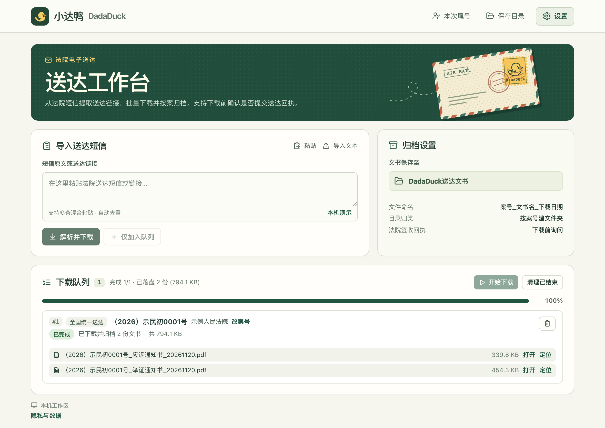
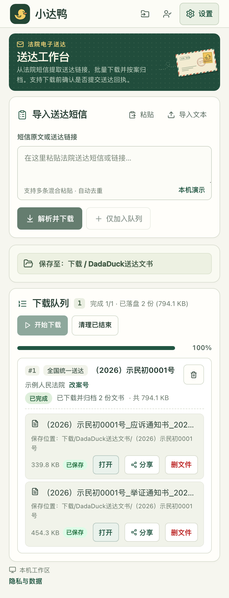

# 小达鸭 DadaDuck

小达鸭是独立开发的法院送达文书归档工具，支持 macOS、Windows 和 Android。它能从用户提供的送达短信提取链接，顺序下载文书并按案归档。取件、送达与回执状态以对应法院平台为准。

## 界面预览

以下截图为桌面端和 Android 布局的界面预览，使用虚构案件与示例文书。

| 桌面端（PC） | Android 端 |
| :---: | :---: |
|  |  |

## 0.3.2

- 右上角新增「设置」入口。关于页位于设置底部，桌面端也可通过原生菜单打开。
- 关于页补充木小樨的小红书二维码、版权声明和免责声明。

## 0.3.1

- **下载前确认签收**。全国统一送达找到文书后，默认逐案询问是否向法院提交送达回执。可选「仅下载」或「提交回执并下载」，并勾选记住本次选择。随时可在归档设置改回「下载前询问」。无法确认提交结果时标记为待核实，可前往法院页面查看，其余平台仍在法院页面办理。
- **内置取件窗口限定来源**。桌面端只在原始 HTTPS 来源提供取件和填码协助。遇到跨站登录、跳转或下载时，可改用系统浏览器，并在桌面端导入下载好的文书。Android 用系统浏览器取件，提取码由用户主动复制。
- **缩短凭证留存**。短信、取件 URL、提取码和常用尾号仅用于当前运行。重启后需重新导入未完成案件。升级时会移除旧历史中的凭证和设置中的尾号，已归档文书及待保存文书可继续处理。
- **本机演示**。在短信输入框下方点「本机演示」，用虚构通知体验核验和归档。演示会生成一份本机 TXT 文书。

应用支持全国统一送达和湖北免账号送达的直连，广东电子送达、集约送达、湖北账号模式和部分司法送达链接可走浏览器。具体入口和验证流程由各送达平台提供，使用前请确认你有权访问对应文书，并遵守平台的使用条件。

## 隐私与数据

短信与链接在设备上解析。取件时将必要的送达参数发送至对应平台，尾号只在用户提交身份核验时发送给对应平台。系统浏览器有独立的历史、Cookie 和隐私设置。

应用在本机保留案号、文书名、保存位置和归档状态。提交签收时，另存取件标识的摘要和回执结果，防止下载重试时再次提交。页脚「隐私与数据」可清除应用记录和暂存，已归档文书会保留。Android 的应用数据排除在备份及设备迁移规则之外。反馈问题时请使用虚构示例，不要提交真实姓名、案号、完整取件链接、验证码或文书。

## 免责声明

小达鸭由个人独立开发，用于辅助下载和归档法院送达文书。应用中的下载、归档与回执状态供操作参考。请以法院平台记录及法院正式通知核实文书内容、送达时间、签收状态和相关期限。

请仅处理自己有权访问的案件文书，提交回执前核对案件信息，下载后核对文书份数与内容。请遵守对应送达平台的使用条款，并妥善保护短信、链接、验证码和文书。本项目按 [许可证](LICENSE) 原样提供。

## 构建

源码和各平台安装包见 [GitHub Releases](https://github.com/muxiaoxiii/dadaduck-public/releases)。自行构建需要 Node.js 22、Rust 和对应平台的 [Tauri 构建依赖](https://v2.tauri.app/start/prerequisites/)。

```bash
npm ci
npm run build
cargo test --locked --manifest-path src-tauri/Cargo.toml
npm run tauri -- dev
```

桌面打包时在对应系统运行：

```bash
npm run tauri -- build
```

在配置 Android SDK 36、NDK 和 JDK 后构建 Android：

```bash
npm run tauri -- android init
python3 scripts/patch-android-project.py
npm run tauri -- android build --apk --target aarch64
```

自行分发时请使用自己的发布签名。Android 覆盖安装要求签名一致，从临时签名版迁移前请导出需要的文书。面向普通 macOS 用户交付 DMG 时，请使用 Developer ID 签名并完成 Apple notarization。

## 许可证

DadaDuck 采用 [PolyForm Noncommercial 1.0.0](LICENSE)，允许按条款进行非商业使用、修改与再分发。商业使用请联系作者取得单独授权。[版权声明](NOTICE)
